# Focus and selection across the themes (2026-11-05)

The owner chose one grammar for focus and selection on 2026-11-05 from mock-ups
drawn in Moy Night (`docs/theme_and_shell_2026-11.md` §1.5, landed in
`320a5b60e`). Selected is a fill. A focused row wears a 4 px bar at its left,
with no fill. A focused button, tab or cell wears a 2 px ring 2 px clear of it.
Touch shows neither. On the T-Deck the owner then saw three problems:

- the control center's separators disappear beside the focused row;
- its card sits flush on the panel's top;
- the other themes look different.

This folder audits every theme on every surface that wears a mark, and
proposes how themes declare their marks. The owner's direction for it
(2026-11-05): the engine does not fix what focus and selection look like; a
theme declares any mark per item kind, and the engine and the loader check
only that the result can be read. Every image comes from the real toolkit.
`tools/focus_shots.py` builds the goldens' workstation through
`tools/look_shots.py`'s `render` and draws every surface in every state.

```bash
W=$(mktemp -d)
.venv/bin/python tools/focus_shots.py docs/media/focus_2026-11 --runs today --work $W
# from a scratch worktree with marks_prototype.patch applied and
# tools/gen_ui_tables.py run, writing into this folder:
.venv/bin/python tools/focus_shots.py OUT --runs proposal --work $W
.venv/bin/python tools/focus_shots.py OUT --runs checks   # the L-check table
# back here:
.venv/bin/python tools/focus_shots.py docs/media/focus_2026-11 --runs findings --work $W
```

## Reading the renders

The images are in three folders:

- `today/` shows what dev draws, at `810f6d445`.
- `proposal/` shows the proposal: the seeds' declared marks, drawn by the
  prototype engine (`marks_prototype.patch`).
- `findings/` holds the numbered crops this README cites.

Each run has these sheets:

| sheet | what it holds |
|---|---|
| `surface_<surface>_tdeck.png` | the state sheet on the T-Deck (320×240), shown at 2×: one row per theme-mode, one column per state |
| `surface_<surface>_desk.png` | the same sheet in a window on the desk (1024×600), shown at 2× |
| `surface_<surface>_shell.png` | the real shell's screens, at 1×, on both sizes |
| `theme_<theme>-<mode>_tdeck.png`, `theme_<theme>-<mode>_shell.png` | one theme-mode's contact sheets: every surface in that theme |

The theme-modes are Moy Night (`moy-dark`), Moy Day (`moy-light`), Blocks
(`blocks-light`, its one mode), Contrast dark and Contrast light.

**The state sheet** is a system app (`Sheet` in the tool) that draws one surface
per page with the public verbs. It covers:

- a group card (`ui.link`, `ui.toggle`, `ui.slider`);
- a plain list (`ui.list`) and a table (`ui.table`);
- a menu (`ui.menu`);
- buttons of every kind (`ui.button`);
- a dialog (`ui.dialog`);
- tabs and segments (`ui.tabs`, `ui.seg`);
- cards and tools (`ui.grid` and `ui.card`, `ui.tool`);
- fields (`ui.field`).

Each item is labelled with its own state. "Selected" is drawn with
`o.current`, "Disabled" with `o.disabled`, and the danger kind is labelled
"Danger".

A cell's caption names its frame's state:

- `rest`: focus is on the page's "Other" button, so every item shows at rest.
- `focus-<item>`: that stop holds the focus.
- `focus-selected`: the focus is on the selected item.
- `pressed`: a finger is held on the item.
- `touch-*`: touch is the input.

**The shell screens** are these:

- Settings, with Volume, Steady (a toggle) and the empty Name field focused;
- the control center: open, Brightness focused and Wi-Fi focused;
- Files, and the desk with Files and Calc;
- the system menu over the home, the pause menu, the desk's system menu and
  the desk's power popover;
- the delete question on both sizes;
- the bar's status cluster and the Moy button focused;
- the home's tiles, Calc and the desk's PROJECTS window.

## The audit: what ships today

Ranked by how much each breaks the owner's grammar.

**1. In Blocks and Contrast, focus is a fill.**
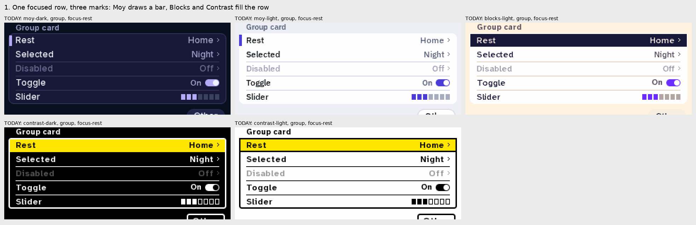
Moy draws a focused row as the bar. Blocks fills the row in its ink, and
Contrast fills it in yellow. The cause is the themes' `look.focus`: Moy has
`edge`, while Blocks and Contrast have `invert` for every part that is not a
card (`native/moy_ui/themes/blocks.json`, `contrast.json`). The same split
holds on every surface: buttons, menus, tabs, fields, keys and tools (see
`today/surface_*_tdeck.png`).

**2. A fill means opposite things in different themes.**
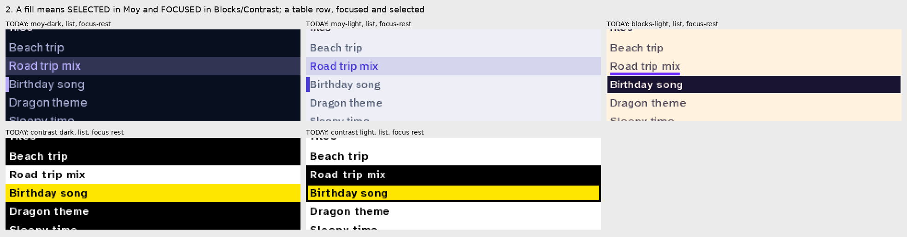
- In Moy, a fill is the selected row.
- In Blocks, a fill is focus, and the selected row is an underline under its
  label (`current.row: underline`).
- In Contrast, both marks are solid fills. Yellow is focus, white or black is
  selected, and only the colour tells them apart.

A table's current row follows its focus. So in Blocks and Contrast, a focused
table shows only the focus fill, and the selected mark is not shown at all
(`today/surface_table_tdeck.png`).

**3. A group row cannot be selected.**
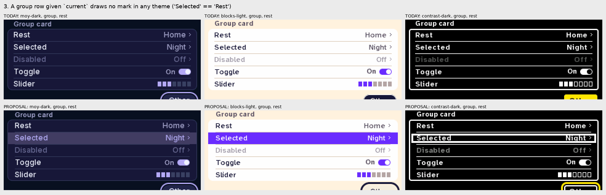
`moy_ui_vrow` in `native/moy_ui/moy_ui_parts.c` draws the focus mark, but it
never draws `MOY_UI_F_ON`, although `mua_mark_flags` passes it. So `ui.link`,
`ui.toggle` or `ui.slider` with `o.current` look the same as a row at rest, in
every theme. "Selected = a fill" has no drawing on the very card it was chosen
for. Table rows and list rows do draw it.

**4. The rules vanish beside the bar, and the bar sits on the card's frame.**
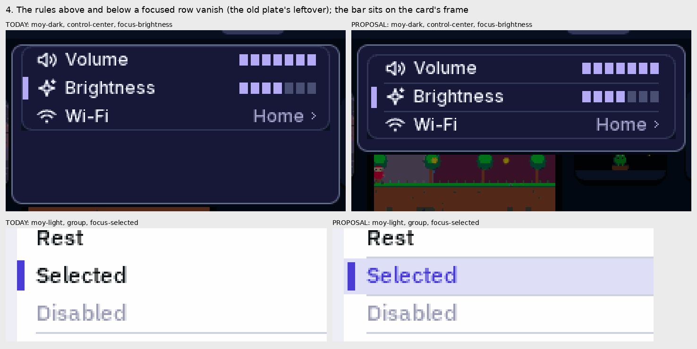
This is the owner's defect (a). In `native/moy_ui/moy_ui_api.c`, `mua_band`
treats a focus style as filling its row when it is `invert` or `edge`. A row
that fills draws no rule, and neither does the row under it. `edge` lost its
plate on 2026-11-05, so the hairlines above and below a focused row now go
missing for nothing. The cause is the same in Settings and in the control
center.

`on_card_mark` also puts the bar flush against the frame's inner edge. On a
card's first row and its last, the bar's corner meets the arc of the card's
rounded corner (the owner's second photo, and the CC crop here).

**5. The control center's card sits flush on the panel's top, and the panel's foot is empty.**
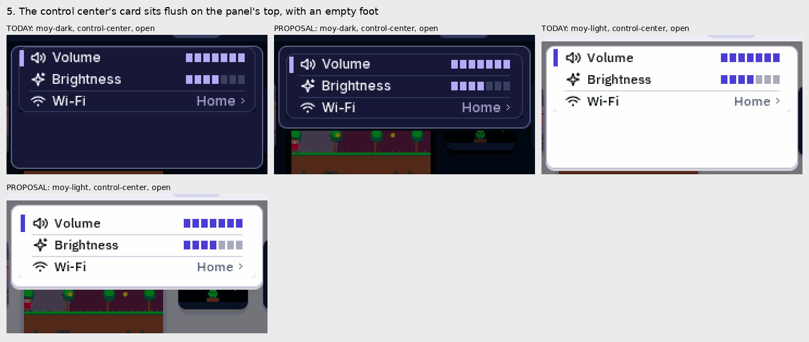
This is the owner's defect (b). In `runtime/system/popover.py`,
`ControlCenter.column()` sizes the panel with 12 px of pad at its top and 12 px
at its foot. `ControlCenter.draw()` then places the card 1 px under the top.
The card is 1 px from the top, 7 px from the sides, and the pad it was given
sits empty under it.

**6. The box's shape picks the mark, not the part.**
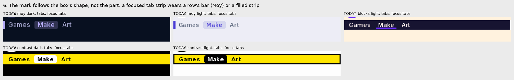
The `edge` case in `moy_ui_focus_in` (`native/moy_ui/moy_ui_depth.c`) draws a
bar on any box at least three times as wide as it is tall. It draws a ring only
when the caller passes `MOY_UI_MARK_CELL`. Buttons pass it, so a wide button
still rings (`today/surface_buttons_tdeck.png`, "focus-wide"). A choice
strip does not: `ui.tabs`, `ui.seg` and `ui.swatches` are one stop whose box
is the whole strip. So a focused tab row wears a row's bar beside the strip in
Moy, and a filled strip in Blocks and Contrast. §1.5 says a tab wears the ring.

**7. A fill hides what the part is.**
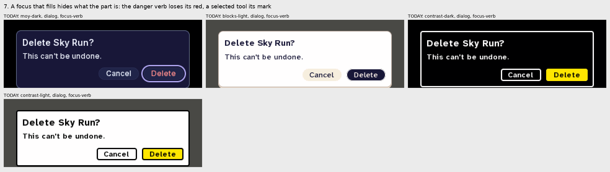
`invert` replaces both the part's fill and its ink:
- Contrast's focused Delete loses its danger red.
- A focused Primary and a focused Normal look the same.
- Blocks' focused selected tool covers its underline.
- On a card's row, Contrast's yellow focus hides the row's toggle state
  (`today/surface_group_tdeck.png`).

**8. A focused field wears two marks.**
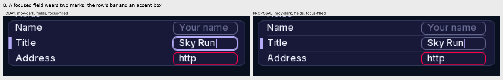
A focused field gets the row's bar and also an accent border on its box (the
text field's ring). The Music spec (`docs/media/music_2026-11/README.md`,
"Focus marks") gives the field the bar *in place of* the accent border. A field
in error keeps its danger border either way.

**9. A pressed button looks like Primary, or like focus.**
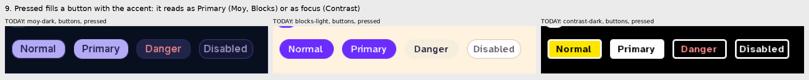
In `native/moy_ui/style.json`, every button kind's pressed field is
`["pressed", "hilite", 13]`, and `hilite` is the accent in every seed theme.
So a pressed Normal button looks like Primary in Moy and Blocks, and like a
focused button in Contrast. A group row has no pressed state at all: a finger
held on it shows nothing (the "pressed" column of
`today/surface_group_tdeck.png`).

**10. A focused card lifts in Moy and rings everywhere else.**
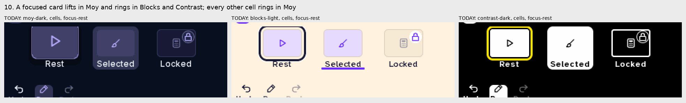
Moy has `focus.card: lift`, and every other cell in Moy rings. In the desk's
PROJECTS window, the shelf's focused tile lifts while the buttons above it ring
(`today/surface_cells_shell.png`). That is two focus shapes for cells in one
window.

**Smaller findings:**
- A focused bar needs Contrast light's keyline too. `focus.outline` (2 px
  black) is drawn round the ring, which keeps its yellow readable on white. The
  `edge` case draws no outline, though, and a bare yellow bar on white is about
  1.3:1. This only shows once Contrast uses the bar.
- The selected mark on a pill button is drawn square. On Moy's "Toggle on"
  button, the `current` plate ignores the button's radius
  (`today/surface_buttons_tdeck.png`).
- Under touch, every theme drops both focus marks (✓). The selected fill stays
  (✓).

## The marks: defaults plus legibility (proposed)

The owner's direction (2026-11-05): the engine does not hard-code what focus
and selection look like. A theme declares one mark per item kind and state, in
its own colours and weights. The engine and the loader check only that the
result can be read. "Selected = fill, row focus = bar, cell focus = ring" is
the default the Moy themes ship. Two fills, one harder and one lighter, are
legal too.

**Item kinds.** Every part that takes focus or a selected state is one of three
kinds, set by what the part is:

| kind | the parts |
|---|---|
| `row` | value rows (links, toggles, sliders, segments in a group), list rows, table rows, menu rows, a field's row |
| `cell` | buttons, tabs (the current tab of a strip), segments standing alone, keys, tools, chips, bar items |
| `card` | grid cards, the home's tiles, the desk's shelf |

**States.** `focus` (keys or the pad are on it), `on` (selected, §3.3's
current state) and `both`: an optional extra mark drawn over the other two
when an item is focused and selected, for a theme whose `focus` would cover
its `on` (Contrast's).

**Marks.** Each is drawn in a role colour (`c`) or `#rrggbb`, at the font
scale:

| mark | drawn | its numbers |
|---|---|---|
| `fill` | a solid fill of the box, the ink over it chosen to clear it (the selection's own ink over `selection`) | — |
| `tint` | the colour over the box at `alpha` | `alpha` |
| `bar` | a bar at the box's leading edge, `gap` in, inset 2 px top and foot when the row is taller than 8 px | `w`, `gap` |
| `ring` | a ring outside the box, `gap` clear of it, following its radius | `w`, `gap` |
| `inset` | a ring inside the box, `gap` in from its edge | `w`, `gap` |
| `outline` | a ring on the box's own edge | `w` |
| `underline` | a line under the box, `gap` in from each side | `w`, `gap` |
| `none` | nothing | — |

Any mark may add `key`, a keyline `[w, colour]` round the mark's shape. A
mark the theme leaves out falls back to the engine's default for its kind.
`pressed` is not a mark: it is a step of the part's own fill (the `pressed`
alias resolves to `sunk`), never the accent.

**The package format.** The key is `look.marks`, nested like every other look
key, and a mode's `look.dark` or `look.light` overrides a leaf:

```json
"marks": {
  "row":  { "focus": { "mark": "bar", "w": 4, "gap": 2, "c": "accent" },
            "on":    { "mark": "tint", "c": "value" } },
  "cell": { "focus": { "mark": "ring", "w": 2, "gap": 2, "c": "accent" } },
  "card": { "focus": { "mark": "ring", "w": 2, "gap": 2, "c": "accent" } }
},
"dark":  { "marks": { "row": { "on": { "alpha": 0.24 } } } },
"light": { "marks": { "row": { "on": { "alpha": 0.18 } } } }
```

The schema is `native/moy_ui/style.json`'s look fields, one per leaf:
`marks.<kind>.<state>.mark` (an enum of the marks above), `.c` (a role),
`.w` and `.gap` (0–8), `.alpha` (0–1) and `.key` (a line). The loader needs no
new parser.

### The seed declarations

| theme | row focus | row on | row both | cell focus | card focus |
|---|---|---|---|---|---|
| Moy | `bar` 4, gap 2, accent | `tint` value, 0.24 Night / 0.18 Day | — | `ring` 2, gap 2 | `ring` 2, gap 2 |
| Blocks | `bar` 4, gap 2, accent (its ink) | `fill` selection (purple, white ink) | `bar` 4 in `selection_ink` (white) | `ring` 3, gap 2 | `ring` 3, gap 2 |
| Contrast | `fill` focus (yellow), light mode with a 2 px black `key` | `inset` 3, gap 2, value (white Night, black Day) | `inset` 2, gap 3, in the ink over yellow | `ring` 3, gap 2, yellow, light mode keyed | `ring` 3, gap 2, likewise |

The picks, theme by theme:

- **Moy** keeps the owner's grammar. Moy Day's selected tint rises from the
  engine's default 0.14 to 0.18 (about `#DEDCF7` on white, 1.33:1, L3). Its cards ring; a lift with
  the ring is legal under the checks, and is the owner's call (question 2).
- **Blocks** keeps the marks the first pass proposed: the ink bar (17.6:1 on
  the card) and the purple fill (6.2:1). On the purple fill the ink bar is
  2.9:1, so `both` turns the bar white. Its danger buttons take the red ink
  (`#b3261e`, 5.6:1 on their fill) in place of the plain ink.
- **Contrast** is the one theme whose focus is a fill. Its yellow row (16.6:1
  on black; on white, the 2 px black keyline carries it) puts black ink on the
  row. Its selected mark is a 3 px frame inside the row, not a second fill,
  because white or black beside yellow is 1.27:1 (L4). Focused and selected,
  the row is yellow with the frame in black. A frame means "selected" in every
  state, and one fill means one thing. Its cells and cards ring, so a focused
  Danger keeps its red and a focused Primary its fill. Disabled ink becomes
  `#8f8f8f` on black and `#6b6b6b` on white (6.5:1 and 5.3:1), apart from the
  full-contrast ink.

**Selection and the cursor.** A list's selected row is the value chosen with
confirm, and it stays where it was chosen while focus moves. A table's selected
row is its cursor, so it follows focus: a focused table always shows the
"both" state on one row. Both are what the toolkit does today; the proposal
keeps them and states them.

The proposal, drawn:

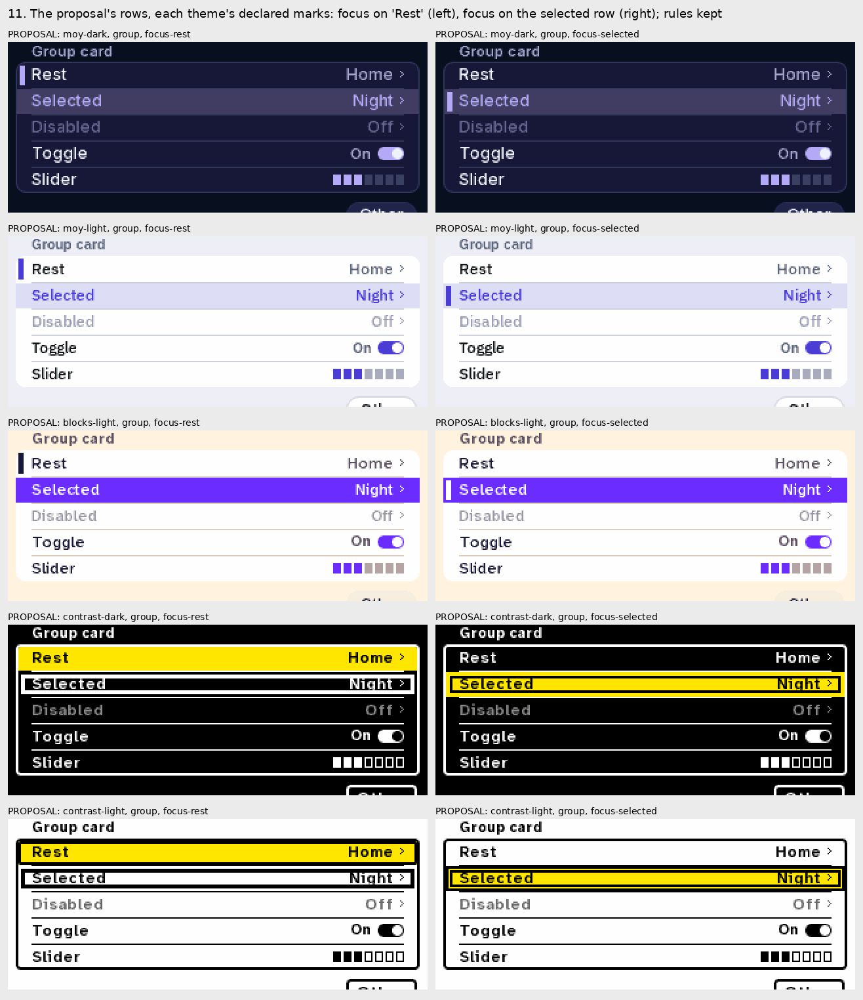
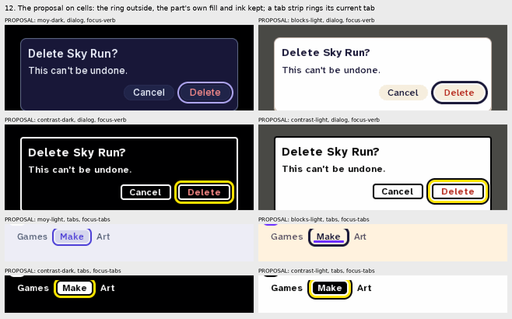
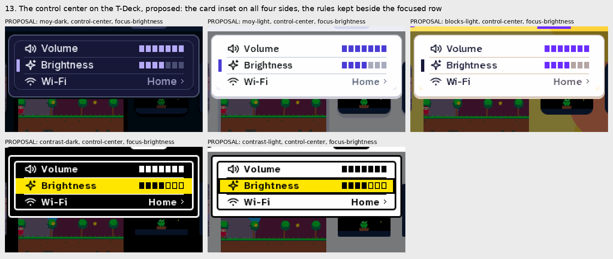
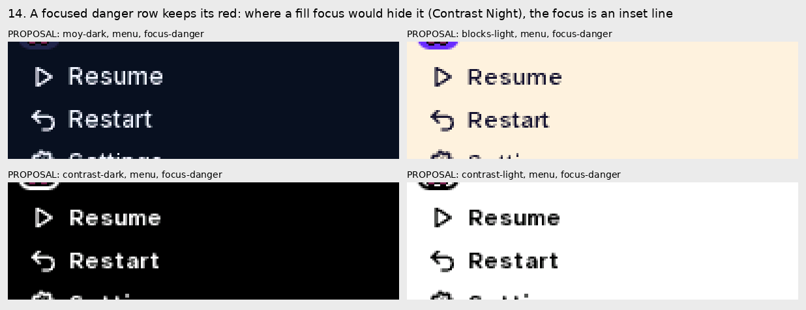
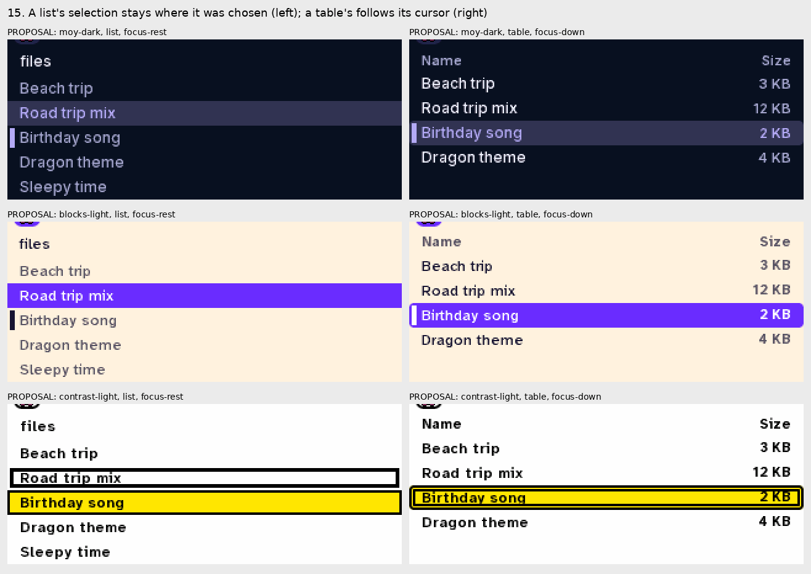

## The legibility checks

The loader holds a package's declarations to these on load (a mark that fails
is dropped and noted, as a bad surface is, §6). The guard test holds the seeds
to them on the rendered state sheets, per theme-mode × surface × state.

| check | what it holds |
|---|---|
| L1 | A focus mark is at least 3:1 against the ground it lands on, or carries a `key` of at least 2 px that is. A `fill` focus puts ink of at least 4.5:1 on itself. |
| L2 | A `bar` is at least 3 px on the T-Deck and 4 px on the desk, and at least 60 % of the row's height. A `ring` is at least 2 px. An `underline` is at least 2 px, under at least 60 % of the label. |
| L3 | `on` is at least 1.3:1 against the rest ground, or at least 1.2:1 with an ink change of at least 3:1. |
| L4 | Rest, focus, on and both are pairwise different, and both keeps a cue of each. Two fills that stand for different states differ by at least 3:1. A focus mark drawn over an `on` fill is 3:1 against that fill. |
| L5 | A danger part's ink and a Primary's fill survive focus. A danger row's ink under a `fill` focus is at least 4.5:1 on it; where it is not, the engine draws the focus as a 3 px `inset` line in the fill's colour and keeps the danger ink. |
| L6 | Rules, card frames and a field's own border beside or under a focus mark are drawn as at rest. |
| L7 | A `ring`'s reach (`gap` + `w` + `key`) plus 4 px fits the space the layout leaves between parts; the toolkit's own layouts (a dialog's buttons) widen their gap to it. A `bar`'s `gap` + `w` + 4 px fits inside the row's text inset. |
| L8 | (Warning) One fill colour means one thing within a theme: selected, Primary and Toggle-on do not share a fill. |
| L9 | Under touch no focus pixel is drawn, and the `on` pixels match the keys' render. |

**The thresholds against the renders.** L1's 3:1 and 4.5:1 are WCAG's
non-text and text bars. L3's 1.3:1 is lower than either on purpose: a
selected tint is an area, not a line, and Moy Night's 1.65:1 and Moy Day's
1.33:1 both read in the renders, where Moy Day's old 1.14:1 did not. L2's
60 % holds the bar's 2 px top and foot inset on a 20 px row (16 px, 80 %).
L7's 4 px is the clearance the owner chose for the ring itself.

The declarations as `tools/focus_shots.py --runs checks` measures them:

| theme-mode | L1 row focus on card / page | L1 ink on a focus fill | L1 cell ring on panel | L3 selected against rest | L4 the both cue | L5 danger ink on focus |
|---|---|---|---|---|---|---|
| moy-dark | 7.93 pass / 8.79 pass | - | 8.79 pass | 1.65 pass | 4.81 pass | 7.65 pass |
| moy-light | 7.03 pass / 6.05 pass | - | 6.05 pass | 1.33 pass | 5.26 pass | 6.54 pass |
| blocks-light | 17.59 pass / 16.00 pass | - | 16.00 pass | 6.15 pass | 6.15 pass | 6.54 pass |
| contrast-dark | 16.57 pass / 16.57 pass | 16.57 pass | 16.57 pass | 21.00 pass | 16.57 pass | 3.09 FAIL |
| contrast-light | 1.27 (keyline 16.57 pass) / 1.27 (keyline 16.57 pass) | 16.57 pass | 1.27 (keyline 16.57 pass) | 21.00 pass | 16.57 pass | 5.16 pass |

L5's FAIL is Contrast Night's declaration alone (its red on yellow is 3.1:1);
the engine's fallback carries it, which is why L5 is a fallback and not a
refusal: `findings/14_danger-keeps-its-ink.png` shows the
focused "Delete cart" in an inset yellow line with its red kept. L6, L7 and L9
are geometric, so only the rendered test can hold them.

## How the proposal renders are made

`proposal/` is drawn by the toolkit itself, with no pixels painted over it.
`marks_prototype.patch` (beside this README) is the prototype: the `marks`
look keys in `native/moy_ui/style.json`, their reader and drawer in
`native/moy_ui/moy_ui_depth.c`, the engine fixes of change list (a), and the
seed declarations above. The tool renders it from a scratch worktree with the
patch applied (`git apply`, then `tools/gen_ui_tables.py`), so the theme
picker shows the active theme as a seed. The control center's inset is the
shell's Python, and the tool patches it at run time (`_cc_inset`). The
prototype is the evidence for the design, not the build: it finds a row by its
shape where the build is to take the kind from the part (change 12).

Not drawn: Contrast's Primary border and Toggle-on check, and its open status
cluster's ink (changes 14 and 15).

## Change list for the build

Each item lands with its golden re-bake. The prototype patch draws items 1,
2, 4 and 6–11 and the declarations of 13; the tool draws item 3.

**(a) Engine defects, which land whatever a theme declares:**

1. **A selected value row draws.** `mua_vrow_draw` in
   `native/moy_ui/moy_ui_api.c` masks `MOY_UI_F_ON` off, so `moy_ui_vrow`
   never sees it. Keep the flag, and draw the row's `on` mark under its focus
   mark with its ink for the label and the value.
2. **Rules stay beside focus.** `mua_band` drops the rules above and under a
   focused row for `invert` and `edge`. A mark that stays inside the row (all
   of them) keeps them.
3. **The control center's inset.** `ControlCenter.draw()` in
   `runtime/system/popover.py` places the card by the group's inset
   (`metrics("group")[0]`) and `column()` counts that inset at the top and the
   foot in place of 12 px.
4. **Focus never hides danger ink.** L5's fallback, in the focus drawer.
5. **The selected mark follows the part's radius** (Moy's pill "Toggle on").
6. **A field in a group wears the row's mark,** and its box keeps its rest
   border (`field.border`, or the caller's `o.border`). A field standing alone
   keeps its ring.
7. **A tab strip rings its current tab,** with the cell mark, not the row's.
8. **Pressed is the part's own step.** The `pressed` alias in
   `native/moy_ui/style.json` resolves to `sunk` and `pressed_ink` to `ink`,
   never to the selection colour. A group row gets a pressed state.
9. **The leading gutter.** `row.pad` becomes 10 and `group.pad` 12, so a bar 2
   px in and 4 px wide keeps 4 px clear of the first glyph (L7).
10. **A dialog's buttons keep the ring's reach** between them (L7).

**(b) The marks system and the declarations:**

11. **`look.marks`.** The schema leaves above, their reader beside
    `marks_of` and one drawer (`km_draw` in the prototype) for every mark
    type. `moy_ui_mark_reach` answers from the declared marks.
12. **The kind comes from the part.** Every call site of `moy_ui_focus_in`
    and `moy_ui_current_in` names its kind (row, cell, card) in place of the
    size class and the `w >= 3 * h` test. `focus.style`, `focus.card`,
    `focus.small` and `current.*` retire into `marks`; under the
    no-migrations rule that is strict readers plus a seed bump, and the
    installable themes in moybyte-org/carts are rewritten in the same step.
13. **The seeds.** The declarations above in
    `native/moy_ui/themes/moy.json`, `native/moy_ui/themes/blocks.json` and
    `native/moy_ui/themes/contrast.json`. Then correct every claim this
    falsifies: §1.5 and §3.3 of `docs/theme_and_shell_2026-11.md`, D-14 and
    the marks table of `docs/media/look_2026-10/DESIGN.md`, and `THEMES.md`
    there.
14. **Contrast's Primary and Toggle-on.** Today they share the inverse fill
    with the selected mark (L8). Primary gets a 3 px border and Toggle-on a
    check.
15. **Contrast's open status cluster** draws its icons in the inverse ink on
    the bar's current chip, which today leaves a blank pill.
16. **The checks.** L1–L5 and L8 in the theme loader
    (`tests/test_theme_loader.py` cases for each refusal). L1–L9 as a render
    test over the state sheet's pages for every seed theme-mode, from
    `tools/focus_shots.py`'s `Sheet` and its `checks`.

## Open questions for the owner

1. **Contrast's selected mark.** The proposal makes it a 3 px frame, so its
   one fill (yellow) means focus and nothing else. The alternative keeps the
   solid white or black plate and gives "both" the frame instead, which fails
   L4 (yellow beside white is 1.27:1) and L8 (the plate is also Primary's and
   Toggle-on's fill).
2. **Moy's cards: ring, or lift with the ring?** Both pass the checks. The
   proposal rings them, as every other Moy cell rings.
3. **L3's floor of 1.3:1** is below WCAG's 3:1 on purpose (an area tint, not
   a line). Moy Day's 0.18 tint is the lightest that passes; a firmer floor
   would darken every Day selection.
